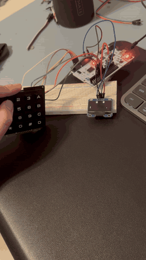

# chip8

A CHIP-8 emulator written in Zig (0.17).

## Run

```
zig build run -- rom/ibm_logo.ch8
zig build test
```

## STM32 port

The emulator core (`src/chip8.zig`) has no file I/O, no allocator, and no platform code, so the same core runs on the PC (SDL) and on an STM32F446RE (Nucleo board).

The firmware in `firmware/` is bare-metal C (no HAL). The Zig core links into it as one object file.

```
cd firmware
make flash                                   # rom/ibm_logo.ch8
make flash ROM="../rom/Pong (1 player).ch8"  # any other ROM
make probe                                   # keypad wiring test
```

Works now:

- 128x64 SH1106/SSD1306 OLED over I2C at 400 kHz. Each CHIP-8 pixel is a 2x2 block. Only changed columns are sent.
- 4x4 matrix keypad, scanned once per frame. Keys map to CHIP-8 by position.
- 60 Hz timing from SysTick, about 11 instructions per frame. Missed frames run after a slow screen update.
- The ROM is built into flash. Choose it with `ROM=`.
- Passes `3-corax+.ch8`, `4-flags.ch8` and `6-keypad.ch8` on the board.
- LED: on/off each second = running. Fast blink = I2C error. N blinks = CHIP-8 error N.

Still to do:

- Random seed: test it on the board. The code seeds `CXNN` from SysTick at the first key press.
- Buzzer for the sound timer.

Wiring is in `cheatsheet.md`.

## Demo


